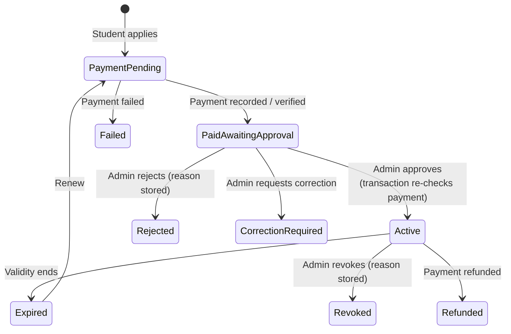
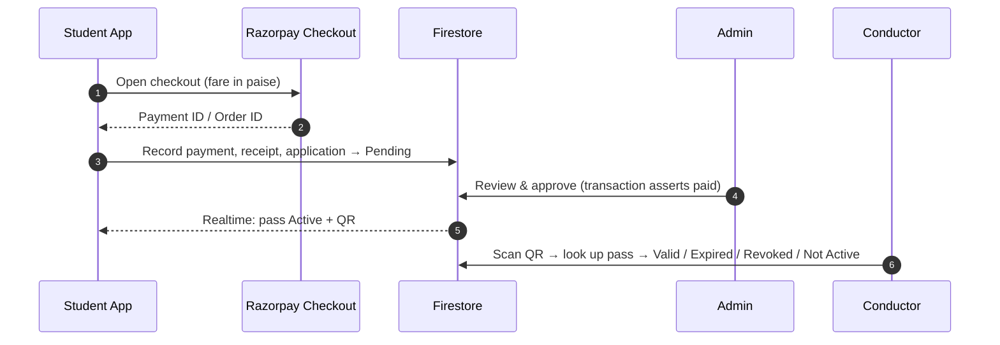

<div align="center">

# 🚌 ICEM Smart Bus Pass

### Pay first. Get verified. Board with a QR.
**A paperless, payment-gated bus pass system for ICEM college, built with Flutter + Firebase.**

[](https://flutter.dev)
[](https://dart.dev)
[](https://firebase.google.com)
[](https://riverpod.dev)
[](https://razorpay.com)

[](https://gitdiagram.com/yashkacholiya61-netizen/bus-pass-management?utm_source=readme&utm_medium=badge)

</div>

---

## 🎯 The Problem

Paper bus passes are slow to issue, easy to forge, painful to renew and impossible to audit. Students queue at the transport office, admins reconcile payments by hand, and conductors squint at laminated cards.

## 💡 The Idea

ICEM Smart Bus Pass moves the whole pass lifecycle onto phones and an admin console, built around one rule:

> **No pass becomes active until payment is verified *and* an administrator approves it. Payment alone never activates a pass.**

Approval is a **two-key process**: a verified payment unlocks the application for review, and an admin's explicit approval issues the pass and its QR.

---

## ✨ Features

### 🎓 Students
- **Register / sign in** with email + password or Google, with email verification
- **Apply and renew** for a pass: pick route, boarding stop and destination
- **Pay with Razorpay Checkout** (fare defaults to ₹4,500)
- **Digital pass with a scannable QR**, active only after payment + admin approval
- **Application history**, per-pass detail screens, payment history and receipts
- **Personalization**: light / dark / system theme and accent colors (crimson, blue, green, purple), synced to Firestore

### 🛠️ Admins (Transport Office Console)
A responsive console (sidebar on desktop, drawer on mobile) with live Firestore streams:

| Area | What it does |
|---|---|
| **Dashboard** | Live KPI cards: students, active passes, pending applications, today's revenue, buses, active drivers, pending payments, expired passes |
| **Pass Management** | Search by name / PRN / college ID, filter by status; approve, reject, or request a correction; full application detail screen |
| **Routes** | Route management with an in-use check before deletion |
| **Buses** | Bus management with automatic bus↔route linking (one bus per route, applied in a batch write) |
| **Students** | Suspend / activate / delete accounts; approve, reject or revoke a student's pass |
| **Payments** | Unified view of `payments` + `receipts`; verify manual payments, mark failed, refund (status), export PDF receipts |
| **Notifications** | Compose alerts targeted at all students, a route, a bus or one student; schedule, edit and delete them |
| **Reports** | Custom-painted line/area, donut and bar charts; CSV and PDF export helpers |
| **Settings** | Profile, appearance, notification preferences, security (password change / reset) |
| **Drivers** | Driver records (add, update, delete) |

### 🧑‍✈️ Staff / Conductors
- Staff dashboard and a **camera QR scanner** (`mobile_scanner`)
- Verification looks the pass up in Firestore by pass number, pass ID or student ID, and returns one of: **Valid**, **Expired**, **Revoked**, **Not Active**, or **Invalid**
- Manual entry fallback when a QR can't be scanned

---

## 🔐 Security Model

| Layer | What it enforces |
|---|---|
| **Admin repository** | `approveApplication` runs in a **Firestore transaction** that re-reads the application and aborts unless `paymentStatus` is paid. It then atomically issues a Pass ID + Pass Number (`ICEM-BP-<year>-<suffix>`), stamps `approvedBy` / `approvedAt`, sets validity (default **180 days**, admin-adjustable) and writes the student's `bus_passes` doc with a QR payload |
| **Admin UI** | Unpaid applications show a locked *Payment Required* button instead of *Approve* |
| **Firestore rules** | Students can't write `passNumber`, `qrCode`, `approvedBy`, `approvedAt`, `validFrom`, `validUntil`, `passStatus`, `applicationStatus`, set `status` to Approved/Active, or mark `paymentStatus` as paid on applications; new applications must start pending/unpaid; routes, buses, notifications, config, reports and audit logs are write-restricted |
| **Pass state** | A pass counts as active only if `paid && approved && !expired && !revoked` |
| **Cloud Functions** | `functions/` implements server-side Razorpay order creation (amount read from the stored fare, double-payment guard), HMAC-SHA256 signature verification, and a payment webhook. Verification marks the application *Pending admin approval*, **never** approved |
| **Routing** | `go_router` redirects keep unauthenticated users on public pages and gate `/admin/*`, the staff dashboard and QR verification by role |

---

## 🔄 Pass Lifecycle



## 💸 Payment Flow



> The `functions/` directory contains the hardened server-side flow (order creation → signature verification → webhook). Wiring the Flutter client to call it is on the [roadmap](#-roadmap), and it is the intended production path.

---

## 🏗️ Architecture

**Feature-first Clean Architecture**, Riverpod for state, Firestore streams as the source of truth.

```
lib/
├── app/                  # MaterialApp.router + theme wiring
├── config/               # constants, go_router + role guards, themes & design tokens
├── core/                 # failures, UseCase base, responsive helpers
├── features/
│   ├── auth/             # login, register, onboarding, splash (data / domain / presentation)
│   ├── student/          # dashboard, apply/renew, digital pass, history
│   ├── bus_pass/         # pass model, repository, QR verification
│   ├── payment/          # Razorpay service, payment config, receipts
│   ├── admin/            # console tabs, charts, report exporter, detail screens
│   ├── driver/           # driver repository & providers
│   └── notification/     # targeted + scheduled notification records
├── services/             # Firebase init (+ FCM), SharedPreferences settings sync
└── shared/               # cards, buttons, skeleton loaders, status badges, empty/error states

functions/                # Node 20 Cloud Functions (Razorpay order, verify, webhook)
firestore.rules           # role- and field-level security
firestore.indexes.json    # composite indexes
test/                     # widget + unit tests
```

### Firestore Collections

| Collection | Purpose |
|---|---|
| `users` | Profiles, roles, preferences |
| `bus_pass_applications` | Application + payment + approval state |
| `bus_passes/{uid}` | The student's live digital pass |
| `payments`, `receipts` | Payment attempts and official receipts |
| `bus_routes`, `buses`, `drivers` | Fleet data |
| `notifications` | Targeted / scheduled alerts |
| `system_config` | Payment configuration (`payment_config`) |
| `reports`, `audit_logs` | Admin-only |

## 🧰 Tech Stack

| Layer | Choice |
|---|---|
| UI | Flutter (Material 3), Google Fonts (Outfit), `CustomPaint` charts and onboarding art |
| State / routing | `flutter_riverpod`, `go_router` |
| Backend | Firebase Auth, Cloud Firestore, Storage, Cloud Messaging |
| Server logic | Cloud Functions (Node 20), `razorpay` SDK |
| Payments | `razorpay_flutter` |
| QR | `qr_flutter` (generate), `mobile_scanner` (scan) |
| Documents | `pdf`, `share_plus`, `path_provider` |
| Media / permissions | `image_picker`, `image_cropper`, `permission_handler` |

---

## 🚀 Run It Locally

**Prerequisites:** Flutter SDK (Dart `^3.12.2`), a Firebase project (Auth, Firestore, Storage), Node.js 20 + Firebase CLI for the functions, and a Razorpay account (test keys are fine).

```bash
git clone https://github.com/yashkacholiya61-netizen/bus-pass-management.git
cd bus-pass-management
flutter pub get
```

1. **Connect Firebase:** add your own `android/app/google-services.json` (and `GoogleService-Info.plist` for iOS), or run `flutterfire configure`.
2. **Add assets** referenced in `pubspec.yaml`: `assets/images/bus_logo.png` and `assets/images/college_upi_qr.png`.
3. **Deploy rules, indexes, functions:**
   ```bash
   firebase deploy --only firestore:rules,firestore:indexes
   cd functions && npm install && cd ..
   firebase functions:config:set razorpay.key_id="rzp_test_xxx" razorpay.key_secret="xxx" razorpay.webhook_secret="xxx"
   firebase deploy --only functions
   ```
   (Functions also read `RAZORPAY_KEY_ID`, `RAZORPAY_KEY_SECRET`, `RAZORPAY_WEBHOOK_SECRET` from the environment.)
4. **Configure payments:** set your Razorpay Key ID and fee in the `system_config/payment_config` document (or the admin Settings screen). Without a Key ID the app refuses to open checkout rather than faking a payment.
5. **Create the first admin:** register normally, then set that user's `role` to `Admin` in the `users` collection.
6. **Run:** `flutter run` (or `flutter run -d chrome` for the console).

## 🧪 Tests

```bash
flutter test
```
Covers payment models/config, the settings screen and theme persistence, and admin application card behavior. Some widget tests predate recent UI copy changes and need updating.

---

## 🗺️ Roadmap

- **Wire the app to Cloud Functions** (`cloud_functions` package) so order creation and signature verification happen server-side, with the client only displaying the result
- **Move role assignment server-side** (custom claims / admin-only writes) and split *Staff* from *Admin* privileges in Firestore rules
- Fix the Razorpay webhook to verify against the raw request body
- A scheduled function to deliver scheduled notifications via FCM and to mark passes **Expired**
- Replace placeholder dashboard stats (staff scan counts) with live data
- Live bus tracking, offline-tolerant QR validation, and audit-log entries for every admin action

## 🤝 Contributing

1. Fork and create a feature branch
2. Keep the `data` / `domain` / `presentation` split per feature
3. Never move payment or approval decisions into unprivileged client code
4. Run `flutter analyze` and `flutter test` before opening a PR

---

<div align="center">

**Built for ICEM students and transport staff.**
*Verified payment + admin approval = an active pass.* 🎟️

</div>
